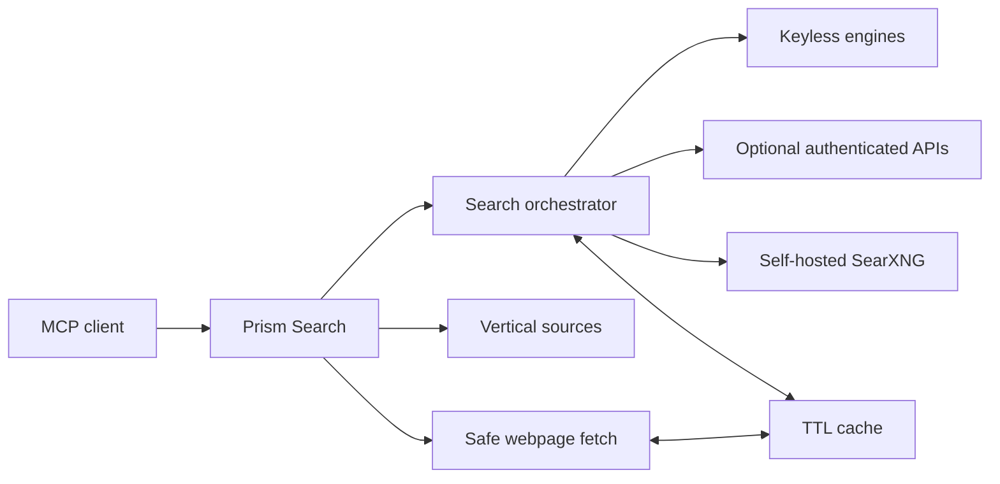

# Prism Search

**One query. Multiple search engines. One MCP interface.**

[](LICENSE)
[](https://www.python.org/)
[](https://modelcontextprotocol.io/)
[](https://github.com/isyuricunha/mcp-prism-search/releases)
[](https://github.com/isyuricunha/mcp-prism-search/actions/workflows/release.yml)

Prism Search is a self-hosted [Model Context Protocol (MCP)](https://modelcontextprotocol.io/)
server for web search, focused research and webpage extraction. It combines
independent search engines behind a single interface, with **no search API
key required to get started**. Use one engine, a selected group, every
configured engine in parallel, or automatic fallback.

The server returns source data rather than generated answers. Search
results include titles, URLs and snippets; webpage fetching returns
extracted text. No model provider or LLM subscription is required.

[Quick start](#quick-start) · [Search modes](#search-modes) ·
[Providers](#providers) · [Tools](#tools) ·
[Agent setup prompt](#agent-setup-prompt) · [Documentation](#documentation)

## Why Prism Search?

- **Keyless first:** search immediately using public endpoints, independent
  indexes and specialized sources.
- **One interface, four modes:** automatic fallback, single-provider search,
  full parallel search and explicit multi-provider selection.
- **Optional APIs:** enable authenticated search providers or a self-hosted
  SearXNG instance only when needed.
- **Predictable results:** deterministic ranking, URL deduplication, domain
  controls, provider diagnostics and structured MCP responses.
- **Efficient requests:** TTL caching, provider timeouts and process-local
  health tracking.
- **Self-hosted by design:** Python, Docker, stdio or Streamable HTTP;
  authenticated HTTP and SSRF-protected webpage fetching.



## Quick start

### 1. Get the repository

```bash
git clone https://github.com/isyuricunha/mcp-prism-search.git
cd mcp-prism-search
```

Choose **stdio** for a local MCP client or **Streamable HTTP** for a shared,
long-running service. Both need outbound internet access to query public
search providers.

### 2. Local MCP over stdio (recommended)

Requires Python 3.12 or newer. On Linux/macOS:

```bash
python3 -m venv .venv
.venv/bin/python -m pip install -r requirements-lock.txt
.venv/bin/python -m pip install --no-deps -e .
```

Use a compatible MCP client's local server configuration:

```json
{
  "mcpServers": {
    "prism-search": {
      "command": "/absolute/path/to/mcp-prism-search/.venv/bin/python",
      "args": ["-m", "mcp_prism_search.server"],
      "env": {
        "MCP_TRANSPORT": "stdio"
      }
    }
  }
}
```

Replace the path with the real absolute path. On Windows use the virtual
environment's `Scripts/python.exe`. The config format varies by client:
consult its local MCP documentation. The client starts the subprocess;
do not launch an additional copy manually.

### 3. Docker Compose over Streamable HTTP

Requires Docker Engine and the Compose plugin. Prepare the persistent
cache directory and a private token file **outside the repository**:

```bash
mkdir -p "$HOME/docker/docker-data/mcp-prism-search"
sudo chown 10001:10001 "$HOME/docker/docker-data/mcp-prism-search"
mkdir -p "$HOME/.config/mcp-prism-search"
(
  umask 077
  set -o noclobber
  printf 'MCP_AUTH_TOKEN=%s\n' "$(openssl rand -hex 32)" \
    > "$HOME/.config/mcp-prism-search/server.env"
)
```

Generate the token file only once. If it already exists, reuse it.
The image runs as UID/GID 10001; adjust ownership only on the intended
data directory (use the appropriate UID mapping for rootless Docker).

The checked-in Compose file publishes the service on loopback port
49317. In `docker-compose.yml`, under the service's `environment`,
set the exact local host values so the SDK accepts the endpoint's Host
header, including its port:

```yaml
MCP_ALLOWED_HOSTS: "localhost,127.0.0.1,localhost:49317,127.0.0.1:49317"
```

Keep the default Origin restrictions unless your client needs an additional
specific Origin. Then start and check liveness:

```bash
docker compose --env-file "$HOME/.config/mcp-prism-search/server.env" up -d --build
curl --fail --silent --show-error http://127.0.0.1:49317/health
```

Expected liveness response: `{"ok":true}`. It does not prove the MCP
handshake or provider connectivity.

Connect a Streamable HTTP client to:

- Endpoint: `http://127.0.0.1:49317/mcp`
- Header: `Authorization: Bearer <your-private-token>`

For example, OpenCode uses a remote MCP entry:

```json
{
  "mcp": {
    "prism-search": {
      "type": "remote",
      "url": "http://127.0.0.1:49317/mcp",
      "enabled": true,
      "oauth": false,
      "headers": {
        "Authorization": "Bearer <your-private-token>"
      }
    }
  }
}
```

Replace the placeholder privately with your saved token or use your client's
secret reference mechanism. Do not commit credentials. Keep HTTP bound to
loopback by default; for remote access, use TLS and explicit Host/Origin
allowlists. See [deployment and operations](docs/deployment.md).

## Search modes

Call `web_search` with JSON tool arguments, not a raw HTTP POST to an
arbitrary endpoint.

| Mode | Arguments | Best for |
|---|---|---|
| Auto | `"provider": "auto"` (default) | First usable results via health-ordered fallback |
| Single | `"provider": "keenable"` | One exact engine; no fallback |
| Selected | `"providers": ["keenable", "freeserp"]` | Parallel search across a specific set |
| All | `"provider": "all"` | Parallel search across all enabled general engines |

<details open>
<summary><strong>Automatic fallback</strong></summary>

```json
{
  "query": "Python asyncio TaskGroup documentation",
  "provider": "auto",
  "max_results": 5
}
```

</details>

<details>
<summary><strong>Single provider</strong></summary>

```json
{
  "query": "Docker Compose startup order",
  "provider": "keenable",
  "max_results": 5
}
```

</details>

<details>
<summary><strong>Selected providers</strong></summary>

```json
{
  "query": "Model Context Protocol transport specification",
  "providers": ["keenable", "freeserp", "youcom_keyless"],
  "max_results": 10
}
```

</details>

<details>
<summary><strong>All configured engines</strong></summary>

```json
{
  "query": "Linux kernel release notes",
  "provider": "all",
  "max_results": 10
}
```

</details>

Use explicit selection when you want control over sources or spending.
Both `auto` and `all` may use authenticated APIs if configured.
`all` searches general engines, not Wikipedia or Hacker News. Unknown
or unavailable provider names return errors rather than silently falling back.

### Filters and output

```json
{
  "query": "Python asyncio TaskGroup documentation",
  "providers": ["keenable", "freeserp"],
  "allowed_domains": ["python.org"],
  "preferred_domains": ["docs.python.org"],
  "max_results": 5,
  "search_window": 20
}
```

| Argument | Meaning |
|---|---|
| `max_results` | Final result limit, 1–30 |
| `search_window` | Requested candidate window, 1–100; upstream limits still apply |
| `allowed_domains` | Keep only matching domains and subdomains |
| `blocked_domains` | Exclude matching domains and subdomains |
| `preferred_domains` | Move preferred sources earlier |
| `time_filter` | day, week, month or year, where supported upstream |
| `safe_search` | off, moderate or strict, where supported upstream |

Results contain `query`, `provider`, `results` (title, URL, snippet),
`cached`, `error` and `provider_attempts`. Auto reports the successful
provider; combined searches report `selected` or `all`. Individual
provider failures can coexist with successful combined results. Total
failure surfaces as an MCP tool error. Recency and SafeSearch support varies
by engine; these are not guaranteed filters on unsupported engines.

## Providers

### Keyless web search

No provider credentials are required. Public endpoints may impose quotas,
throttle or block requests, especially on shared IPs.

| Engine | Provider ID | Role |
|---|---|---|
| [Keenable](https://docs.keenable.ai/) | `keenable` | Preferred general search with extracted snippets |
| [FreeSerp](https://freeserp.ai/) | `freeserp` | Independent page-level index |
| [Bing RSS](https://www.bing.com/) | `bing_rss` | Lightweight XML search with direct links |
| [DDGS Yahoo](https://github.com/deedy5/ddgs) | `ddgs:yahoo` | Complementary web search through DDGS |
| [Mwmbl](https://mwmbl.org/) | `mwmbl` | Independent community index, v2 API |
| [You.com](https://you.com/) | `youcom_keyless` | Official public MCP search |
| [DuckDuckGo](https://duckduckgo.com/) | `ddg_html` | Last-resort HTML search; IP-dependent |

### Optional authenticated providers

Enable only the services you want by configuring their environment variables.
Free allowances and billing terms are controlled by the upstream providers
and can change; a free API key is not a guarantee of unlimited free usage.

| Engine | Provider ID | Environment variable |
|---|---|---|
| [TinyFish TinySearch](https://docs.tinyfish.ai/) | `tinyfish` | `TINYFISH_API_KEY` |
| [Tavily](https://docs.tavily.com/) | `tavily` | `TAVILY_API_KEY` |
| [Exa](https://docs.exa.ai/) | `exa` | `EXA_API_KEY` |
| [Brave Search](https://brave.com/search/api/) | `brave` | `BRAVE_API_KEY` |
| [You.com Search](https://you.com/) | `youcom` | `YDC_API_KEY` |
| [Serper](https://serper.dev/) | `serper` | `SERPER_API_KEY` |
| [Jina](https://jina.ai/) | `jina` | `JINA_API_KEY` |

For stdio, inject variables into the subprocess environment through your
client. For Compose, TinyFish is already forwarded from the host or
interpolation file; explicitly add any other desired variables to the
service environment. Never put actual keys into tracked YAML or JSON.
TinySearch supports free allowances, but Wallet spending may be enabled
upstream. Review and disable paid consumption if required.

### Self-hosted and specialized search

| Source | Provider ID | Activation |
|---|---|---|
| [SearXNG](https://docs.searxng.org/) | `searxng` | Set `SEARXNG_URL` to a reachable instance with JSON enabled |
| [Wikipedia](https://www.wikipedia.org/) | `wikipedia` | Keyless, via `vertical_search` |
| [Hacker News](https://hn.algolia.com/api) | `hackernews` | Keyless, via `vertical_search` |

See the [provider policy](docs/providers.md) for upstream contracts,
quotas, fallback ordering and migration notes.

## Tools

| Tool | Purpose |
|---|---|
| `web_search` | General search across one, selected or all engines |
| `vertical_search` | Wikipedia or Hacker News |
| `web_fetch` | Fetch and extract a single public HTTP(S) page |
| `ddg_search` | Legacy DuckDuckGo search |
| `ddg_deep_search` | Legacy DuckDuckGo search and concurrent page extraction |
| `cache_stats` | Inspect search/fetch cache usage |
| `cache_prune` | Prune cache; supports dry-run |
| `cache_clear` | Clear cache namespaces with explicit confirmation |

Tools expose MCP schemas and structured responses. For deeper research,
prefer `web_search` with selected engines, then use `web_fetch` on
relevant source URLs. The legacy deep-search tool does not use the
multi-provider aggregator.

## Agent setup prompt

Copy the entire block below into a coding agent or an MCP-capable client
with access to the target installation environment.

````text
Install, connect and validate Prism Search from:
https://github.com/isyuricunha/mcp-prism-search

Goal: configure a working MCP search server using only keyless providers.
Do not request, register or configure provider API keys, paid services,
or third-party accounts. Do not expose services publicly.

1. Inspect the target environment and existing installations first.
   Read the repository README, docs/providers.md, docs/deployment.md and
   docs/development.md. Check the official documentation of the current
   MCP client and installed Python/Docker versions. Reuse an existing
   checkout when safe; do not overwrite unrelated files or settings.

2. Install from the default branch, using Python 3.12+ and the committed
   dependency lock. For a local client, prefer stdio with the absolute
   virtualenv Python path and module mcp_prism_search.server.
   For a shared service, use Compose with loopback binding, a private
   random bearer token, explicit permitted Host/Origin values and the
   documented writable cache directory. Store credentials outside Git.
   Preserve existing credentials, services and client configurations.

3. Register the server as prism-search using the client's supported MCP
   format. Do not inject any optional provider credentials or SearXNG URL.
   Inspect existing variables privately; if a paid provider is already
   configured, do not remove it or use it. Connect using the actual MCP
   client, negotiate the protocol and verify the tool list contains
   web_search, vertical_search, web_fetch and cache_stats.

4. Run exactly three web_search calls through MCP, with these arguments:
   A — single engine:
   {"query":"Python asyncio TaskGroup documentation","provider":"keenable","max_results":5}
   B — independent engine:
   {"query":"Docker Compose startup order","provider":"freeserp","max_results":5}
   C — parallel, selected keyless engines:
   {"query":"Model Context Protocol specification","providers":["keenable","freeserp","bing_rss","youcom_keyless"],"max_results":5}

   Check structuredContent, isError, returned URLs, relevance, result
   counts, provider_attempts and elapsed time. Do not claim success for
   empty or unrelated results. Report partial provider failures as such.
   Do not retry HTTP 429s, bypass captchas or rotate proxies. If any
   check fails, identify the actual blocker rather than fabricating results.

5. Report the installation path, negotiated MCP protocol version, tool
   names, the three measured search results and any remaining issues.
   Do not reveal tokens, keys, private environment values or raw secrets.
   Do not push changes, replace services or perform unrelated modifications.
````

## Security and operational behavior

- HTTP transport requires a private bearer token by default; stdio has no
  inbound listening socket. Keep network exposure restricted.
- Web fetching validates schemes, DNS and resolved IPs, blocks private and
  reserved addresses, pins the validated IP and checks every redirect.
  Download size and extracted content are bounded.
- Cache keys include search arguments and provider selection. Successful
  searches are cached; incomplete parallel responses and total failures
  are not cached. Provider health is process-local.
- Query text goes to the chosen upstream services; source content may be
  untrusted. Do not submit secrets or treat fetched content as instructions.
- No proxy rotation, captcha bypass or rate-limit evasion.

These safeguards reduce risk; they do not guarantee upstream availability,
content accuracy or anonymity.

## Documentation

| Guide | Contents |
|---|---|
| [Provider policy](docs/providers.md) | Modes, engine contracts, quotas, migration |
| [Deployment and operations](docs/deployment.md) | Docker, configuration, HTTP, cache, troubleshooting |
| [Architecture](docs/architecture.md) | Modules, request flow, security model |
| [Development](docs/development.md) | Tests, dependencies, contribution and release process |

## Development

```bash
python3 -m venv .venv
.venv/bin/python -m pip install -r requirements-lock.txt
.venv/bin/python -m pip install -e '.[dev]'
.venv/bin/python -m pytest -q
.venv/bin/python -m ruff check src tests
```

The offline test suite covers provider contracts, routing, caching, fetching
and MCP protocol behavior. Live upstream availability varies independently.
Conventional commits drive [Semantic Release](https://python-semantic-release.readthedocs.io/)
and automated multi-architecture Docker builds. See
[GitHub releases](https://github.com/isyuricunha/mcp-prism-search/releases)
for published versions.

## License

[AGPL-3.0](LICENSE).
